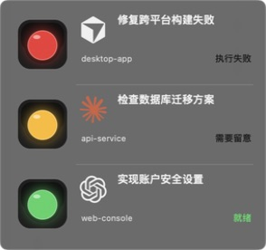
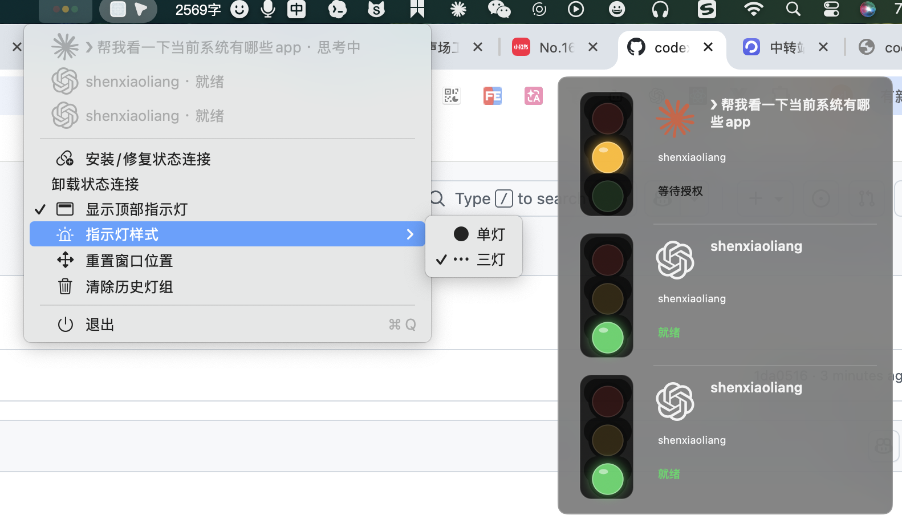

**Language:** [中文](README.md) | English

[aiv123.com](https://aiv123.com/) · AI tools directory, 600+ tools in one place

## 🚀 Recommended: [ofox.ai](https://ofox.io/x/aiv123)

> **In short**: One account for the latest GPT / Claude / Gemini and **100+** top models. First top-up gets an extra **$3** credit.

Text, image, video, and embeddings in one place. Caching supported — repeat calls stay cheaper and faster.

[👉 Sign up](https://ofox.io/x/aiv123) · Global dedicated lines · Enterprise SLA · No conversation retention

| ⚡️ Faster & Leaner | 🧠 Models & Modalities | 🛡️ Privacy |
|:---:|:---:|:---:|
| Global lines, enterprise SLA, plus caching | 100+ models · text / image / video / embeddings | No conversation retention |

## ☕ Buy Me a Coke

Open source takes effort — sponsorship is welcome:  
👉 [Afdian](https://ifdian.net/a/shellsec)

---

# aidengyu (灯语)

[](https://github.com/shellsec/aidengyu/actions/workflows/build.yml)

Local agent status lights for macOS and Windows. The app lives in the system tray and at the top of the desktop; each Codex, Claude Code, or Cursor session gets its own light group.

<p align="center">
  
</p>

### In use

<p align="center">
  
</p>

## Features

- macOS uses native AppKit with no Dock icon; Windows is a single-file Go + Win32 tray app (a few MB).
- Top panel stays on top across Spaces / desktops; draggable, and always keeps part of itself on-screen.
- Compact single-light by default, or street-style three lights from the menu; sessions stack vertically with error/wait states first.
- Translucent panel background with light dividers between sessions.
- Codex/OpenAI, Claude, and Cursor icons identify the agent (no names); short task titles come from the first line of user input.
- Live Codex, Claude Code, and Cursor lifecycle hooks.
- Menu (or tray) can install/repair/uninstall hooks, show/hide the panel, and clear history.
- Structured merge of `~/.codex/hooks.json`, `~/.claude/settings.json`, and `~/.cursor/hooks.json`, preserving existing fields; timestamped backups before write.
- All state stays on-device — no network, telemetry, or background service.

Full color and blink semantics: [docs/STATE_LANGUAGE.md](docs/STATE_LANGUAGE.md).

## Build

### macOS

Requires macOS 13+ and Xcode Command Line Tools (full Xcode not required).

```bash
Scripts/test.sh
Scripts/build-app.sh
```

`build-app.sh` produces a Universal app (`dist/aidengyu.app`), ad-hoc signs it, and calls `Scripts/create-dmg.sh` for a drag-install DMG:

- `dist/aidengyu.app`
- `dist/aidengyu-macOS-universal.dmg`

Or build a DMG from an existing `.app` (macOS only, uses `hdiutil`):

```bash
Scripts/create-dmg.sh dist/aidengyu.app
```

#### Install (drag)

1. Open `aidengyu-macOS-universal.dmg`.
2. Drag **aidengyu.app** into **Applications**.
3. Launch from Applications.

Dev run without installing: `open dist/aidengyu.app`.

### Windows

Requires [Go](https://go.dev/dl/) 1.22+. Details: [Windows/README.md](Windows/README.md).

```powershell
.\Windows\build-windows.ps1
```

Cross-compile Windows x64 from macOS / Linux:

```bash
Windows/build-windows.sh
```

Artifacts: `dist-windows/aidengyu.exe`, `dist-windows/aidengyu-Windows-x64.zip`.

## GitHub Actions

Push to `main`, open a PR, or run **Build** manually — parallel jobs produce:

- `aidengyu-macOS-universal.zip`
- `aidengyu-macOS-universal.dmg` (recommended install)
- `aidengyu-Windows-x64.zip`

Download from the workflow run **Artifacts**. Pushing a `v*` tag also creates/updates a GitHub Release with those assets:

```bash
git tag v0.4.1
git push origin v0.4.1
```

## Connect Codex, Claude Code, and Cursor

1. Open the menu bar / tray status icon.
2. Choose **Install / repair status connection**.
3. Start **new** Codex, Claude Code, and Cursor sessions.
4. On first Codex hook discovery, confirm trust in `/hooks`.

Or install via the packaged helper (macOS):

```bash
dist/aidengyu.app/Contents/Helpers/AgentSignalHook --install
```

Uninstall only removes this app’s managed hook entries:

```bash
dist/aidengyu.app/Contents/Helpers/AgentSignalHook --uninstall
```

## Local data

macOS:

```text
~/Library/Application Support/aidengyu/sessions/
```

Windows:

```text
%APPDATA%\aidengyu\
```

If a legacy `CodexClaudeSignal` directory still exists, the first launch tries a one-time migrate to `aidengyu`; on failure it keeps reading the old path so light state is not lost.

One JSON file per session: agent type, `session_id`, cwd, event name, status, update time, short error reason, and a task title (≤36 chars from the first line of user input). Hooks do not store full prompts, model output, tool args, or conversation bodies.

## Layout

```text
Native/SignalCore.*              status map, storage, hook merge (macOS)
Native/AgentSignalHook.m         Codex / Claude Code / Cursor hook binary
Native/AgentSignalApp.m          menu bar, top panel, light animation
NativeTests/                     dependency-free core tests
Windows/cmd/signal/              Go entry (tray UI + hook CLI, single exe)
Windows/internal/core/           Windows status map, storage, hook merge
Windows/internal/ui/             Win32 tray and top panel
Windows/assets/app.ico           icon embedded into the exe
Windows/build-windows.ps1|.sh    Windows build and zip
Scripts/build-app.sh             macOS Universal .app (+ create-dmg.sh)
Scripts/create-dmg.sh            macOS drag-install DMG
Scripts/test.sh                  macOS core tests
docs/                            state language and screenshots
.github/workflows/build.yml      parallel macOS / Windows CI
```

## References

Product/UX research drew on these projects; this repo’s code is independent:

- [guan-ops/Agent-Signal-Bar](https://github.com/guan-ops/Agent-Signal-Bar), Apache-2.0
- [yelog/vibebar](https://github.com/yelog/vibebar), MIT
- [michalstrnadel/AgentBar](https://github.com/michalstrnadel/AgentBar), MIT

Codex/OpenAI, Claude, and Cursor marks from [Simple Icons](https://simpleicons.org/), CC0-1.0.

Codex hooks: [OpenAI Codex Hooks](https://learn.chatgpt.com/docs/hooks). Cursor: [Cursor Hooks](https://cursor.com/docs/agent/hooks). Claude Code uses the lifecycle hooks supported by the current CLI.

## License

[MIT](LICENSE)
