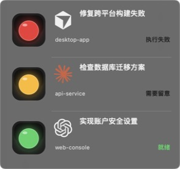
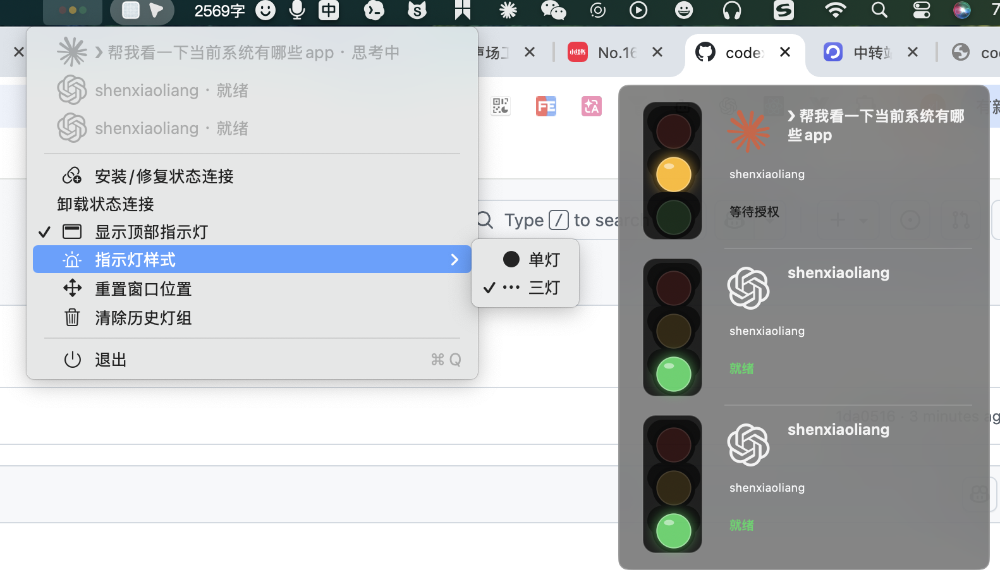

**语言 / Language:** 中文 | [English](README.en.md)

[aiv123.com](https://aiv123.com/) · AI 工具导航，600+ 工具一网打尽

## 🚀 推荐使用 [ofox.ai](https://ofox.io/x/aiv123)

> **一句话**：一个账号直达最新 GPT / Claude / Gemini 等 **100+** 顶尖模型，首充额外赠 **$3** 额度。

文本、图像、视频、向量一站调用；支持缓存，重复请求更省更快。

[👉 注册领取](https://ofox.io/x/aiv123) · 全球专线 · 企业级 SLA · 不留存对话

| ⚡️ 极速更省 | 🧠 模型与模态 | 🛡️ 隐私安全 |
|:---:|:---:|:---:|
| 全球专线，企业级 SLA，支持缓存 | 100+ 模型 · 文本 / 图像 / 视频 / 向量 | 不留存任何对话 |

## ☕ 请我喝可乐

开源不易，欢迎赞助支持：  
👉 [爱发电](https://ifdian.net/a/shellsec)

---

# 灯语（aidengyu）

[](https://github.com/shellsec/aidengyu/actions/workflows/build.yml)

面向 macOS 和 Windows 的本地 Agent 状态指示灯。应用同时常驻系统托盘和桌面顶部；每打开一个 Codex、Claude Code 或 Cursor 会话，就显示一组独立状态灯。

<p align="center">
  
</p>

### 实际使用效果

<p align="center">
  
</p>

## 当前能力

- macOS 使用原生 AppKit 且不显示 Dock 图标；Windows 使用 Go + Win32 原生托盘单文件，体积约数 MB。
- 顶部 `NSPanel` 始终置顶，并加入所有桌面与全屏辅助空间；可拖动，且至少保留一部分在当前屏幕内。
- 默认使用紧凑单灯显示状态，也可从菜单切换为街头红绿灯三灯样式；多个会话垂直排列，异常和等待状态优先。
- 面板使用半透明毛玻璃背景，会话之间以轻量分割线区分。
- 使用 Codex/OpenAI、Claude 与 Cursor 图标区分 Agent，不显示名称；有用户输入时显示从首行提取的任务短标题。
- Codex、Claude Code 与 Cursor 生命周期 Hook 实时上报。
- 菜单栏可安装、修复、卸载 Hook，显示/隐藏顶部面板并清除历史灯组。
- 结构化合并 `~/.codex/hooks.json`、`~/.claude/settings.json` 和 `~/.cursor/hooks.json`，保留已有字段与 Hook；写入前生成时间戳备份。
- 所有状态只保存在本机，无网络请求、遥测或后台服务。

完整颜色和闪烁语义见 [docs/STATE_LANGUAGE.md](docs/STATE_LANGUAGE.md)。

## 构建

要求 macOS 13 或更高版本，以及 Xcode Command Line Tools。无需完整 Xcode。

```bash
Scripts/test.sh
Scripts/build-app.sh
```

`build-app.sh` 生成同时支持 Apple Silicon 和 Intel Mac 的 Universal 应用（`dist/aidengyu.app`），做本地 ad-hoc 签名，并调用 `Scripts/create-dmg.sh` 打出拖拽安装盘：

- `dist/aidengyu.app`
- `dist/aidengyu-macOS-universal.dmg`

也可在已有 `.app` 后单独打 DMG（必须在 macOS 上，依赖系统自带 `hdiutil`）：

```bash
Scripts/create-dmg.sh dist/aidengyu.app
```

### macOS 安装（拖拽）

1. 打开 `aidengyu-macOS-universal.dmg`。
2. 将左侧的 **灯语（aidengyu.app）** 拖到右侧的 **应用程序（Applications）** 文件夹。
3. 从「应用程序」启动「灯语」。

开发时也可直接运行未安装的包：`open dist/aidengyu.app`。

Windows 10/11 x64 版本、使用方法和构建命令见 [Windows/README.md](Windows/README.md)。需要 [Go](https://go.dev/dl/) 1.22+：

```powershell
.\Windows\build-windows.ps1
```

在 macOS / Linux 上也可交叉编译 Windows x64：

```bash
Windows/build-windows.sh
```

产物：`dist-windows/aidengyu.exe`、`dist-windows/aidengyu-Windows-x64.zip`。

## GitHub 自动构建

推送到 `main`、创建 Pull Request，或从 Actions 页面手动运行 `Build`，都会并行构建：

- `aidengyu-macOS-universal.zip`（可选解压使用）
- `aidengyu-macOS-universal.dmg`（推荐：打开后拖到「应用程序」安装）
- `aidengyu-Windows-x64.zip`

构建完成后可在对应 Workflow Run 的 **Artifacts** 区域下载。推送 `v*` 标签时还会自动创建 GitHub Release，并附加上述产物：

```bash
git tag v0.4.1
git push origin v0.4.1
```

## 连接 Codex、Claude Code 和 Cursor

1. 打开菜单栏的三色灯图标。
2. 选择“安装/修复状态连接”。
3. 新开 Codex、Claude Code 和 Cursor 会话。
4. Codex 首次发现 Hook 时，在 `/hooks` 页面确认信任。

也可以用打包后的 Helper 安装：

```bash
dist/aidengyu.app/Contents/Helpers/AgentSignalHook --install
```

卸载只移除本应用管理的 Hook 条目：

```bash
dist/aidengyu.app/Contents/Helpers/AgentSignalHook --uninstall
```

## 本地数据

状态文件位于：

```text
~/Library/Application Support/aidengyu/sessions/
```

若仍存在旧目录 `CodexClaudeSignal`，首次启动会尝试一次性迁移到 `aidengyu`；迁移失败时继续从旧目录读取，避免会话灯状态丢失。

每个会话一个 JSON 文件，只记录：Agent 类型、`session_id`、工作目录、事件名、状态、更新时间、简短错误原因，以及从用户输入首行提取的最多 36 个字符任务标题。Hook 不保存完整 prompt、模型输出、工具参数或对话正文。

## 项目结构

```text
Native/SignalCore.*              状态映射、文件存储、Hook 配置合并（macOS）
Native/AgentSignalHook.m         Codex / Claude Code / Cursor Hook 可执行文件
Native/AgentSignalApp.m          菜单栏、置顶面板和灯光动画
NativeTests/                     无外部依赖的核心测试
Windows/cmd/signal/              Go 入口（托盘 UI + Hook CLI，单文件 exe）
Windows/internal/core/           Windows 状态映射、存储与 Hook 合并
Windows/internal/ui/             Win32 托盘与置顶面板
Windows/assets/app.ico           嵌入 exe 的图标
Windows/build-windows.ps1|.sh    Windows 构建与打包
Scripts/build-app.sh             macOS Universal .app（并调用 create-dmg.sh）
Scripts/create-dmg.sh            macOS 拖拽安装 DMG
Scripts/test.sh                  macOS 核心测试
docs/                            状态规范与截图
.github/workflows/build.yml      并行构建 macOS / Windows 产物
```

## 开源参考

本项目在产品交互和事件接入调研中参考了以下开源项目，但实现代码为独立编写：

- [guan-ops/Agent-Signal-Bar](https://github.com/guan-ops/Agent-Signal-Bar), Apache-2.0
- [yelog/vibebar](https://github.com/yelog/vibebar), MIT
- [michalstrnadel/AgentBar](https://github.com/michalstrnadel/AgentBar), MIT

Codex/OpenAI、Claude 与 Cursor 标志取自 [Simple Icons](https://simpleicons.org/)，按 CC0-1.0 提供。

Codex Hook 事件以 [OpenAI Codex Hooks 文档](https://learn.chatgpt.com/docs/hooks) 为准；Cursor 事件以 [Cursor Hooks 文档](https://cursor.com/docs/agent/hooks) 为准；Claude Code 使用当前 CLI 支持的生命周期 Hook 事件。

## License

[MIT](LICENSE)
